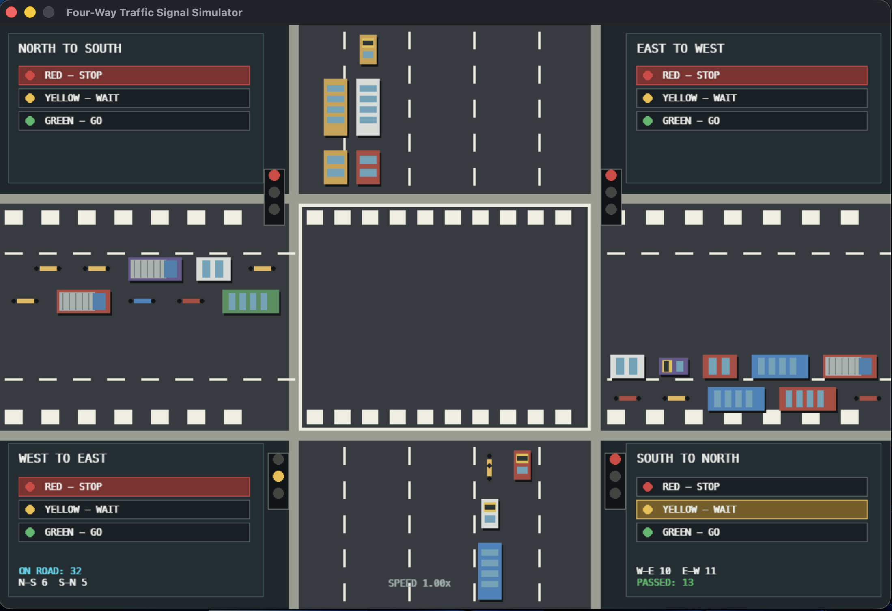

# Four-Way Traffic Signal Simulator

A visual traffic-intersection simulator built with **Python and Pygame**. It displays a four-way intersection with vehicles approaching from different directions, interactive traffic signals, and live traffic statistics.

## Preview



## Features

- **Four-way intersection** with north–south and east–west traffic.
- **Interactive traffic signals** with Red, Yellow, and Green controls.
- **Multiple vehicle types**, including cars, buses, trucks, auto-rickshaws, motorcycles, and scooters.
- **Vehicle spawning and movement** with basic same-lane spacing.
- **Live statistics**, including vehicles on the road, counts by direction, and vehicles passed.
- **Simulation controls** to pause, resume, reset, and adjust vehicle speed.
- **Custom-drawn graphics**, including road markings, pedestrian crossings, vehicles, and signal lights.

## Requirements

- Python 3
- Pygame

## Setup and Installation

### 1. Clone the repository

```bash
git clone <your-repository-url>
cd <your-project-folder>
```

Alternatively, download this project and open its folder in Terminal.

### 2. Create a virtual environment

```bash
python3 -m venv venv
```

### 3. Activate the virtual environment

On macOS or Linux:

```bash
source venv/bin/activate
```

On Windows:

```powershell
venv\Scripts\activate
```

### 4. Install dependencies

```bash
python -m pip install pygame
```

If you maintain a `requirements.txt` file, you can install dependencies with:

```bash
python -m pip install -r requirements.txt
```

### 5. Run the simulator

```bash
python traffic_simulator.py
```

Use the actual Python filename in your project if it differs from `traffic_simulator.py`.

## Controls

| Input | Action |
|---|---|
| Click a signal option | Change the selected traffic signal |
| `Space` | Pause or resume the simulation |
| `R` | Reset the simulation |
| `↑` | Increase simulation speed |
| `↓` | Decrease simulation speed |
| `Esc` | Exit the simulator |

## Project Structure

```text
traffic-simulator/
├── traffic_simulator.py
├── requirements.txt       # Optional dependency list
├── .gitignore
├── README.md
└── screenshots/
    └── traffic-simulator.png
```

A recommended `.gitignore`:

```gitignore
venv/
.venv/
__pycache__/
*.py[cod]
```

## How It Works

1. **Rendering:** Pygame draws the road, lane markings, signal panels, vehicles, and statistics.
2. **Vehicle spawning:** Vehicles are created at the edges of the intersection and assigned a direction, lane, type, color, and speed.
3. **Movement:** Active vehicles advance each frame according to their direction and the simulation speed.
4. **Signal handling:** The selected signal state determines whether vehicles approaching that signal should stop or proceed.
5. **Statistics:** The simulator counts active vehicles and increments the passed-vehicle counter when vehicles leave the screen.

## Limitations

This is a visual simulation intended for learning and demonstration. It does not represent a complete real-world traffic-control system. Depending on the implementation, vehicles from different approaches may still conflict inside the junction, and signal transitions may not include realistic clearance intervals.

## Future Improvements

- Automatic signal cycles with configurable green and yellow durations.
- Adaptive signal timing based on vehicle queues.
- More robust collision avoidance inside the intersection.
- Pedestrian signal phases and pedestrian movement.
- Vehicle-count graphs and traffic-flow metrics.
- Configurable vehicle spawn rates and simulation settings.

## Technologies Used

- **Python**
- **Pygame**

## License

Choose and add a license before distributing or accepting contributions to this project.
